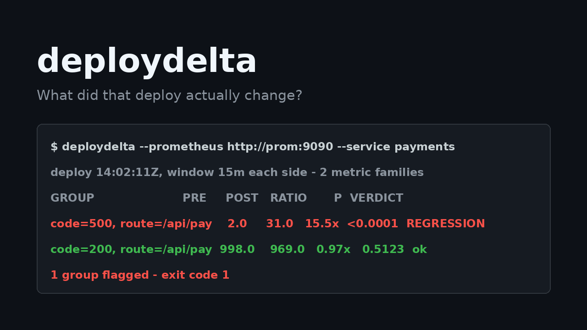

# deploydelta



**After every deploy, someone opens 10-15 dashboards and eyeballs them.** Alerts can't help - they're always on, so they can't tell "this metric shifted because of the deploy" from normal variance. deploydelta is the deploy-aware check: point it at your Prometheus, give it the deploy time, and it tells you what actually moved, with statistics instead of vibes.

```console
$ deploydelta --prometheus http://prom:9090 --service payments --since 2026-11-13T14:02:11Z
deploy at 2026-11-13T14:02:11Z, window 15m on each side - 1 metric familie(s) compared

GROUP                                            PRE     POST   RATIO       P  VERDICT
code=500, route=/api/pay                         2.0     31.0   15.5x  <0.0001  REGRESSION
code=200, route=/api/pay                       998.0    969.0   0.97x   0.5123  ok

2 group(s), 1 flagged
$ echo $?
1
```

Exit code 1 on regression - wire it into your pipeline, Argo Notifications, or a Slack webhook and stop glancing at Grafana on your phone.

## Why not...

- **Alerts** - always on, so they can't distinguish deploy-caused shifts from normal variance. deploydelta only compares the windows around *this* deploy.
- **Argo Rollouts AnalysisTemplates** - you must define every metric upfront, and you need Kubernetes. deploydelta discovers standard HTTP/gRPC request counters by convention; no metric definitions, no k8s required.
- **Datadog Deployment Gates** - a paid platform. deploydelta is one binary against the Prometheus you already run (VictoriaMetrics and other PromQL-compatible backends work too).
- **An LLM staring at your metrics** - this is a two-proportion z-test. Explainable, testable, free.

## Install

```sh
go install github.com/ofershap/deploydelta@latest
```

Or grab a binary from [Releases](https://github.com/ofershap/deploydelta/releases).

### Install for agents

Tell your agent: "Install the Go CLI `github.com/ofershap/deploydelta@latest`, then after my next deploy run `deploydelta --prometheus <url> --service <name> --since <deploy-time>` and show me what shifted."

## Usage

```
deploydelta --prometheus URL --service NAME --since TIME [flags]

  --prometheus   Prometheus base URL (env DEPLOYDELTA_PROMETHEUS)
  --service      service name as it appears in service/job/app labels (env DEPLOYDELTA_SERVICE)
  --since        deploy time, RFC3339 or unix seconds (env DEPLOYDELTA_SINCE) [required]
  --window       comparison window on each side of the deploy (default 15m)
  --metric       override: compare this metric instead of convention discovery
  --query        override: full PromQL increase expression returning by-group vectors
  --min-count    minimum post-window count to flag a group (default 20)
  --ratio        post/pre ratio that counts as a regression (default 2.0)
  --p            p-value threshold for significance (default 0.01)
  --no-fail      always exit 0, only report
```

**Discovery.** deploydelta probes common request-counter conventions (`http_requests_total`, `http_server_requests_total`, `grpc_server_handled_total`, histogram `_count`s, ...) and matches your service against `service`, `service_name`, `job`, `app`, `application`, `container` labels. It splits traffic by route/handler/status labels so a shift is attributed to the endpoint that moved. If nothing matches, it prints the service-ish label values it found so you can override with `--metric` or `--query`.

**Exit codes.** `0` nothing flagged, `1` at least one group flagged, `2` usage or discovery error. If the post window is still open (you ran it 5 minutes after the deploy with `--window 15m`), it says so and compares partial data.

## What the verdict means, honestly

- A group is flagged only when its post/pre ratio passes `--ratio`, its share-of-traffic change passes a two-proportion z-test at `--p`, and its post-window count clears `--min-count`. Low-traffic routes don't get flagged on noise; the flip side is that real regressions on very low-traffic routes won't be caught either. Tune `--min-count` down if you care about those.
- It compares request counters. It does not watch logs, traces, business KPIs, or latency distributions (histogram `_count`s cover latency *volume*, not percentiles). It answers "what moved", not "why".
- Discovery relies on naming conventions. Unconventional metric names need `--metric`/`--query`.

<details>
<summary>Q&A</summary>

**Does it need Kubernetes?**
No. It talks to the Prometheus HTTP API over the network. Run it from your laptop, CI, or a pipeline step.

**Does it work with VictoriaMetrics / Mimir / Thanos?**
Anything that serves the Prometheus v1 HTTP API and PromQL. Tested against the Prometheus API shape; report issues for other backends.

**Can it gate a pipeline?**
Yes - that's the point of exit code 1. Run it after the deploy step; fail the stage on a flagged group.

**Does it roll back automatically?**
No. It surfaces evidence; a human or your own automation decides. (Automatic rollback based on a threshold you didn't think about is how pagers go off at 3am for nothing.)

**What about continuous verification between deploys?**
That's what alerts are for. deploydelta deliberately covers only the post-deploy window that alerts can't contextualize.
</details>

## License

MIT
